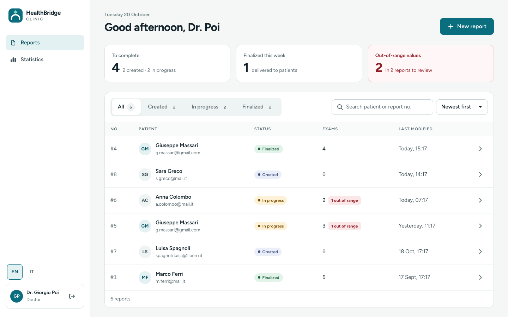
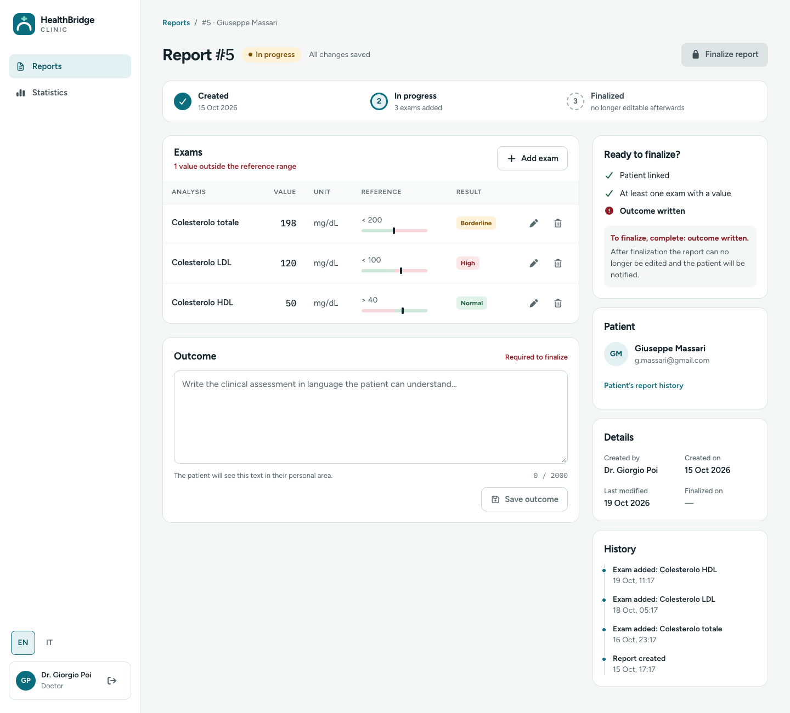
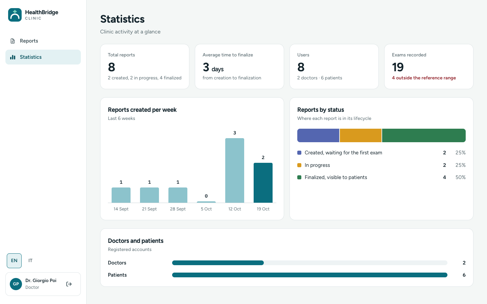
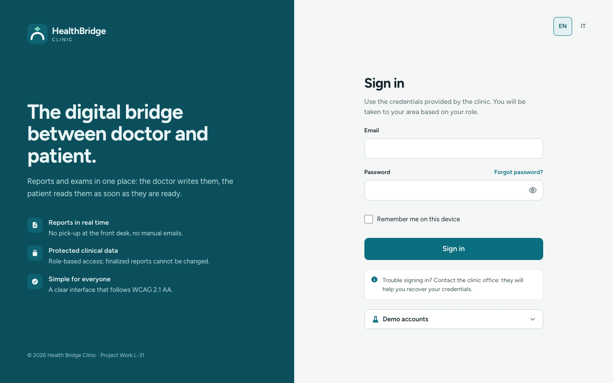
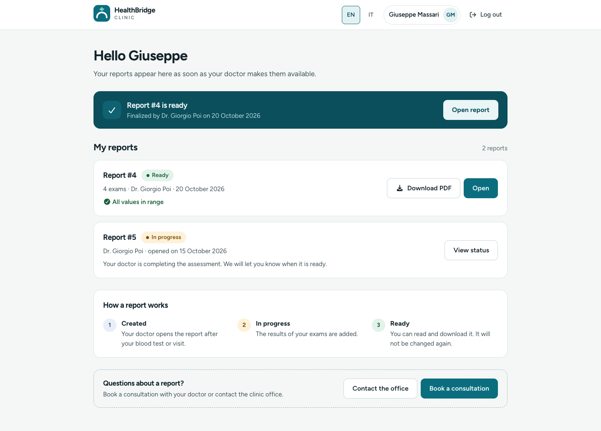
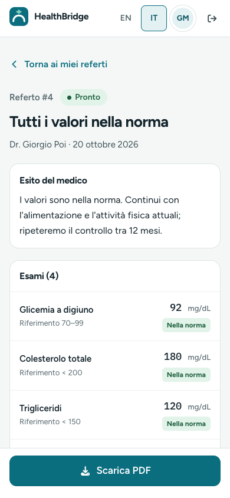

# Health Bridge Clinic

A full-stack web application for a private clinic: a digital **bridge between doctors and patients**.
Doctors create medical reports, record lab exams and write an outcome; once a report is finalized it
becomes read-only and the patient can read it (and save it as PDF). Doctors also see clinic statistics.

This repository is an improved version of my BSc thesis project (L-31, Pegaso University).
Original thesis repository: _link to be added_.



| Report editor | Statistics |
|---|---|
|  |  |

| Login | Patient home | Mobile (Italian) |
|---|---|---|
|  |  |  |

## Features

- **Role-based access** (RF01): doctors and patients land in their own area after signing in.
- **Report lifecycle** `CREATED → IN_PROGRESS → FINALIZED` (RF02–RF05). Adding the first exam moves a report
  in progress; finalization needs a patient, at least one exam and an outcome; finalized reports are immutable.
- **Exams with reference ranges**, flagged Low / High / Borderline (within 5% of a limit) / Normal.
- **Patients see only their own reports** (RF09) and only once they are finalized, with a plain-language summary
  and a printable PDF.
- **Statistics** (RF10): totals, average time to finalize, reports per week, reports by status, users.
- **English and Italian** with runtime switching, locale-aware dates and numbers.
- **Responsive** from 360 px to 1440 px and **accessible** (WCAG 2.1 AA: keyboard navigation, focus rings,
  skip link, labelled forms, accessible dialogs, colour never the only signal).

## Tech stack

| | |
|---|---|
| Backend | Java 25, Spring Boot 4, Spring Data JPA, Spring Security (HTTP Basic, BCrypt), Lombok, MapStruct, H2, springdoc OpenAPI |
| Frontend | Angular 21 (standalone components, signals, zoneless), RxJS, TypeScript, Tailwind CSS 4, Font Awesome |
| Tests | JUnit 5 + Mockito, Vitest |

Architecture: the backend is layered (controller → service → repository) with DTOs and MapStruct mappers;
errors are returned as `{status, code, message, path, fieldErrors}` with stable codes that the frontend
translates. The frontend is organised in feature folders (`auth`, `reports`, `exams`, `patient`, `analytics`,
`users`, `commons`) with shared UI primitives in `commons/ui` and design tokens in `src/styles.css`.

## Prerequisites

- **JDK 25** (the version used in `pom.xml`). Maven is not required: use the wrapper `./mvnw`.
- **Node.js 22 LTS** (or 20.19+ / 24) and **npm 11**. The project declares `npm@11.9.0`; npm 10 can crash on
  install, so if `npm --version` shows 10, run `npx npm@11 install` (or `corepack enable`).

## Run from the terminal

```bash
# Backend: http://localhost:8080 (Swagger UI: /swagger-ui.html)
cd backend
./mvnw spring-boot:run

# Frontend: http://localhost:4200
cd frontend
npm install
npm start
```

Tests and builds:

```bash
cd backend && ./mvnw verify          # compiles, runs the JUnit tests, packages the jar
cd frontend && npm test -- --watch=false
cd frontend && npm run build
```

### Database

H2 runs in file mode (`backend/projectworkmrdb.mv.db`). On an **empty** database the seeder creates the demo
accounts and eight reports in every state, with timestamps spread over the last weeks.
To start again from the demo data, stop the backend and delete the database file:

```bash
cd backend && rm -f projectworkmrdb.mv.db projectworkmrdb.trace.db
```

Do this once after upgrading from the thesis version: the schema changed (reference ranges, longer outcome,
names no longer unique) and Hibernate only adds columns, it never removes constraints.

### Demo accounts

| Role | Name | Email | Password |
|---|---|---|---|
| Doctor | Dr. Giorgio Poi | `g.poi@gmail.com` | `doctor2` |
| Doctor | Dr. Claudia Rossi | `claudiarossi@gmail.com` | `doctor1` |
| Patient | Giuseppe Massari | `g.massari@gmail.com` | `patient1` |
| Patient | Luisa Spagnoli | `spagnoli.luisa@libero.it` | `patient2` |

Four more patients (`patient3` … `patient6`) are seeded. In development builds the login page has a
"Demo accounts" box that fills these in; it is hidden in production builds (`showDemoAccounts` in
`src/environments`).

## Run in IntelliJ IDEA

1. **File → Open** the repository root. When asked, load `backend/pom.xml` as a Maven project.
2. **Settings → Build, Execution, Deployment → Compiler → Annotation Processors**: tick *Enable annotation
   processing* (needed by Lombok and MapStruct). The Lombok plugin is bundled with IntelliJ.
3. Set the project SDK to JDK 25 (**File → Project Structure → Project**).
4. Run `BackendApplication` (green arrow next to `main`).
5. Frontend: open `frontend/package.json` and click the run icon next to `start`, or create an **npm** run
   configuration with the `start` script. Run `npm install` once first.

## Run in Eclipse

Use **Eclipse IDE for Enterprise Java and Web Developers 2025-12 or newer** (Java 25 support).

1. **Lombok**: close Eclipse and run the installer that Maven already downloaded, pointing it at your Eclipse
   installation:
   `java -jar ~/.m2/repository/org/projectlombok/lombok/1.18.42/lombok-1.18.42.jar`
   (run `./mvnw compile` once in `backend` if the file is not there yet).
2. **Window → Preferences → Maven → Annotation Processing**: select *Automatically configure JDT APT*, so that
   MapStruct mappers are generated (m2e-apt).
3. **Window → Preferences → Java → Installed JREs**: add JDK 25 and make it the default.
4. **File → Import → Maven → Existing Maven Projects** and select the `backend` folder.
5. Run `src/main/java/.../BackendApplication.java` with **Run As → Java Application** (or **Run As → Maven
   build…** with the goal `spring-boot:run`).
6. Frontend: open the `frontend` folder with **File → Open Projects from File System**. Wild Web Developer
   (bundled) provides TypeScript, HTML and CSS editing. Start the app from the **Terminal** view
   (`npm install`, then `npm start`) or with an **External Tools** configuration that runs `npm` with the
   argument `start` in the working directory `${project_loc}`.

**Troubleshooting**

- *Mapper implementations cannot be found* (`ReportsMapperImpl`): check step 2, then **Project → Clean** and
  **Maven → Update Project**.
- *Getters/setters missing*: Lombok is not installed in Eclipse (step 1); restart Eclipse afterwards.
- *Unsupported class file major version*: Eclipse or the project runs on a JDK older than 25.

Lombok prints `sun.misc.Unsafe` deprecation warnings when it runs on JDK 25. They come from Lombok itself and
do not affect the build.

## Project structure

```
backend/   Spring Boot API (controller, service, repository, model, dto, mapper, exception, config)
frontend/  Angular app (src/app/<feature>/{pages,components,models,services}, src/styles.css for tokens)
docs/      Screenshots
bruno-collection/  Example API requests (Bruno)
```

## Known limitations

- **HTTP Basic credentials are kept in the browser** (session storage, or local storage with "Remember me")
  because Basic Auth is part of the original design. A production version should switch to a server session
  cookie (Spring Session with CSRF protection) or short-lived tokens.
- **Password reset, notifications and appointment booking** are placeholders.
- Report history is reconstructed from timestamps; a dedicated audit table would be needed for a full log.

See [CHANGELOG.md](CHANGELOG.md) for what changed from the thesis version and why.

## Author

Roberta Matera
