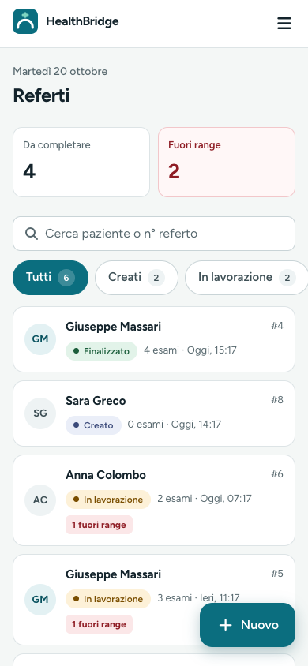

# Health Bridge Clinic

Health Bridge Clinic is a medical reports application for a private clinic. Doctors create and manage medical reports, add laboratory exams with reference ranges, and finalize clinical outcomes. Patients see only their own reports; Patients see only their own reports. Once a report is finalized, they can read the outcome in plain language and print a ready-to-share version.

Evolved from my BSc thesis project — see the [original version](https://github.com/RobertaMatera/rm-project-work-16).

## Technology stack

| Layer | Stack |
|---|---|
| Backend | Java 25, Spring Boot 4, Spring Data JPA, Spring Security, BCrypt, H2, Springdoc OpenAPI |
| Frontend | Angular 21, TypeScript, RxJS, Tailwind CSS 4, Font Awesome |
| Testing | JUnit 5 + Mockito, Angular unit tests with Vitest |

## Screenshots


| Doctor dashboard | Report editor |
|---|---|
|  |  |

| Statistics view | Patient report view |
|---|---|
|  |  |

| Patient report on mobile | Doctor report on mobile |
|---|---|
|  |  |

## Key features

- Role-based access for doctors and patients.
- Medical report lifecycle: `CREATED → IN_PROGRESS → FINALIZED`.
- Exam entries with reference ranges and value classification (`Low`, `High`, `Borderline`, `Normal`).
- Patients see only their own reports; outcomes become visible once finalized.
- Clinic statistics such as totals, average finalization time, weekly report volume, and status breakdowns.
- English and Italian locale switching at runtime.
- Responsive layout for mobile and desktop, with accessibility-oriented UI patterns.

## Design decisions

- One brand color, bridge teal `#0B6E7F`, every other color assigned a single meaning (report status, out-of-range values, and UI emphasis).
- Status is never conveyed by color alone; every state includes a text label (WCAG 2.1 AA, 1.4.1).
- Plain language for patient-facing states, such as “Ready” instead of “Finalized”.
- KPI tiles and bar charts replace pie charts for faster comparison and clearer scanning.
- Mobile-first responsive layouts use a sidebar on desktop and a drawer/card layout on phones.

## Architecture and implementation notes

The application follows a clean domain-oriented structure:

- Backend: controller → service → repository layers with DTOs and MapStruct mappers.
- Security: HTTP Basic authentication with BCrypt password hashing and role-based endpoint protection.
- API consistency: a shared error response format carries status, code, message, path, and field-level validation details.
- Frontend: feature-oriented Angular structure for auth, reports, exams, patient views, analytics, and shared UI primitives.
- Demo data: the backend seeds realistic users and reports in multiple states for a complete local demo experience.

## Prerequisites

- JDK 25
- Node.js 22 LTS (or 20.19+ / 24)
- npm 11 (the project declares `npm@11.9.0`)

> If `npm --version` shows 10, upgrade first with `npx npm@11 install` or enable Corepack.

## Quick start

Run the backend and frontend in separate terminals.

```bash
# Backend (http://localhost:8080, Swagger UI at http://localhost:8080/swagger-ui.html)
cd backend
./mvnw spring-boot:run
```

```bash
# Frontend (http://localhost:4200)
cd frontend
npm install
npm start
```

## Verification and build commands

```bash
# Backend tests and package verification
(cd backend && ./mvnw verify)

# Frontend unit tests
(cd frontend && npm test -- --watch=false)

# Frontend production build
(cd frontend && npm run build)
```

## Demo accounts

The application includes seeded demo accounts for local development and portfolio demos. These are not production accounts and are intended for demonstration only.

| Role | Name | Email | Password |
|---|---|---|---|
| Doctor | Dr. Giorgio Poi | `g.poi@healthbridge.test` | `doctor2` |
| Doctor | Dr. Claudia Rossi | `claudiarossi@healthbridge.test` | `doctor1` |
| Patient | Giuseppe Massari | `g.massari@healthbridge.test` | `patient1` |
| Patient | Luisa Spagnoli | `spagnoli.luisa@healthbridge.test` | `patient2` |

Additional seeded patients use the passwords `patient3` through `patient6`:

- Anna Colombo — `a.colombo@healthbridge.test` — `patient3`
- Marco Ferri — `m.ferri@healthbridge.test` — `patient4`
- Sara Greco — `s.greco@healthbridge.test` — `patient5`
- Paolo Bianchi — `p.bianchi@healthbridge.test` — `patient6`

In development mode, the login page shows a “Demo accounts” helper; the production configuration disables that helper.

## Database and reset

The backend uses H2 in file mode for local development. On a fresh database, the seeder creates realistic demo users and reports across the lifecycle.

To reset the local demo data:

```bash
cd backend
rm -f projectworkmrdb.mv.db projectworkmrdb.trace.db
```

Then restart the backend to reseed the database.

## Security and limitations

- Credentials are held in session storage for the browser tab and sent with each request (HTTP Basic). If the user selects “Remember me,” the credentials are kept in localStorage — acceptable for a local demo only, since they persist and are readable by scripts on the page. A production version would use short-lived tokens (for example, OAuth2/JWT in an HttpOnly cookie) instead of storing the password.
- The project is a demonstration application, not a production-ready clinical system.
- Password reset, notifications, appointment booking, and other operational features are out of scope for this portfolio project.
- Report history is reconstructed from timestamps; a dedicated audit table would be required for full enterprise-grade traceability.
- The application does not claim medical-device compliance, regulatory compliance, or patient-data processing readiness beyond the local demo context.

## AI-assisted development disclosure

I used Claude as an AI-assisted design and development tool throughout this project. I defined the product goals and made the main UX, design-system and architecture decisions; I reviewed, tested and integrated every change and remain responsible for the final code. AI support helped with design-system and UI refinement, accessibility considerations, code review, technical learning, and Git workflow guidance.

## Project background

Health Bridge Clinic began as my BSc thesis project in Information Technology for Digital Enterprises at Pegaso Digital University (2026). The original submitted version is preserved here: [rm-project-work-16](https://github.com/RobertaMatera/rm-project-work-16).

This repository continues that work. The original purpose, functional requirements, and technology stack remain the same, while this version focuses on a redesigned user experience, a more consistent design system, improved responsiveness, and English/Italian localization.

See [CHANGELOG.md](CHANGELOG.md) for the redesign changes that distinguish this version from the original thesis project.

## License

Code is provided under the MIT License. Design, logo, and screenshots are © Roberta Matera, all rights reserved.

## Author
Roberta Matera — [Portfolio](https://www.robertamatera.com/en) · [LinkedIn](https://www.linkedin.com/in/roberta-matera/) · [GitHub](https://github.com/RobertaMatera)
